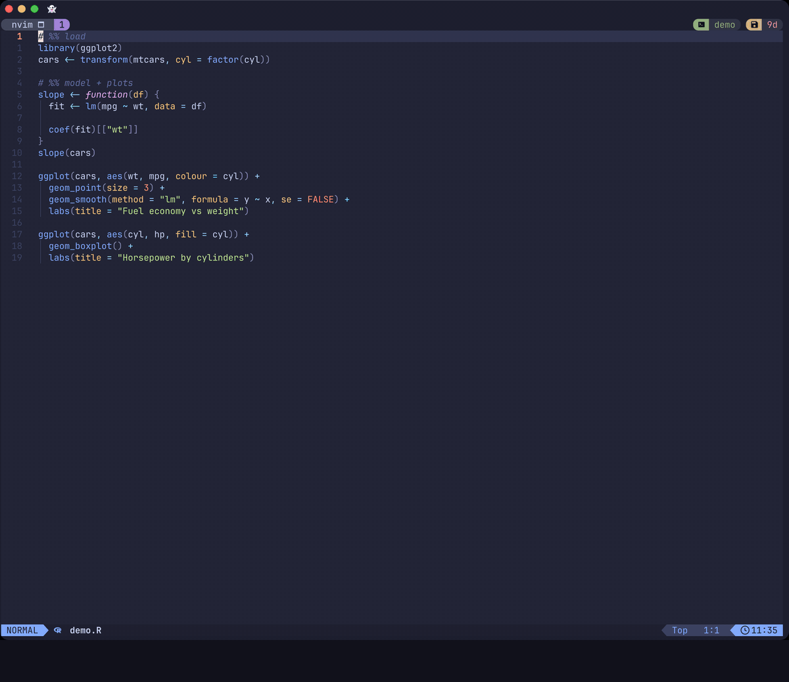

# replstudio.nvim

**Run R and Python line by line, see the plot, check the data, all without leaving Vim.**

Sometimes you just want to poke at some code: run a line, look at the plot, glance at the table. Google Colab is great at this because there is nothing to set up. But it lives in a browser tab, away from your editor and your keys, and it has quirks of its own.

replstudio.nvim brings that quick, setup-free loop into Neovim. It is Vim, extended for data science: minimal, snappy, and out of your way.



<sub>Ghostty + tmux, LazyVim. [Higher-quality MP4](assets/demo.mp4).</sub>

- **Run as you read.** `<Enter>` sends the statement under the cursor and moves to the next: whole functions, loops, pipe and ggplot chains.
- **Plots, right there.** ggplot2, base R, matplotlib and plotnine show up in a side pane as you draw them, with history.
- **No setup.** R and Python are found on their own, on macOS, Linux and Windows. No Python yet? It offers to make a ready-to-use environment with IPython, pandas, matplotlib and plotnine.
- **A parquet viewer that keeps up.** `:e data.parquet` opens any file as a table in a blink, even millions of rows or thousands of columns. Rows and columns stream in as you scroll, so you never wait.
- **Quarto aware.** Send chunks from a `.qmd`; the code runs in the document's folder, as `quarto render` does.
- **Snappy by design.** Nothing loads until you open an R or Python file, and nothing polls in the background.

## Requirements

- Neovim ≥ 0.11, Treesitter parsers for `r` and `python`
- [snacks.nvim](https://github.com/folke/snacks.nvim) (ships with LazyVim)
- A terminal with kitty graphics (Ghostty, kitty, WezTerm). Under tmux: `set -g allow-passthrough on`
- Optional: `ragg` for R plots, [`duckdb`](https://duckdb.org) for parquet

## Install (lazy.nvim)

```lua
{
  "matthewgson/replstudio.nvim",
  ft = { "r", "python", "quarto" },
  cmd = "ReplStudio",
  event = "BufReadCmd *.parquet",
  opts = {},
}
```

On LazyVim with the `lang.r` extra, also add `{ "R-nvim/R.nvim", enabled = false }` to free `<Enter>`.

## Keys

Buffer-local in `r`, `python` and `quarto` buffers, under `<leader>i`.

| Key | Action |
|---|---|
| `<Enter>` | Send statement (or selection) and advance |
| `<S-Enter>` / `<leader>ic` | Send cell or Quarto chunk |
| `<leader>ir` | Toggle REPL |
| `<leader>io` | Browse REPL output (`q` back) |
| `<leader>ip` | Toggle plot pane |
| `<leader>il` | Cycle layout: studio → side → focus |
| `<leader>is` | Source file |
| `<leader>ii` / `ix` / `iR` / `iq` | Interrupt / clear / restart / quit |
| `<leader>iz` | Zoom plot |
| `<leader>iv` | Interpreter info |
| `<leader>if` | Find a column by name (parquet files) |
| `[p` / `]p` | Previous / next plot |

In the plot pane: `h`/`l` browse, `o` open, `y` copy path, `s` save, `d` delete, `z` zoom, `q` hide.

In a parquet file: `w`/`b` next/previous column, `K` full cell, `gg`/`G` first/last row (`{n}G` row n), `0`/`$` first/last column, `q` close. Only the part around the view is loaded, so `/` searches that part.

## Options (defaults)

```lua
opts = {
  prefix = "<leader>i",          -- false: no <leader> maps
  layout = "studio",
  size = { plots = 0.38, repl = 0.30 },
  float = { width = 0.45, height = 0.55 },
  auto_open_plots = true,
  quarto = { cwd = "file" },     -- or "root"
  plot_scale = 1.0,
  parquet = { rows = "auto", max_width = 32 }, -- rows per chunk ("auto": by column count)
  r = { cmd = nil },             -- e.g. { "radian" }
  python = {
    cmd = nil,
    venv = "~/.local/share/replstudio/venv",
    packages = { "ipython", "matplotlib", "plotnine", "pandas", "numpy" },
    version = nil,
  },
}
```

Commands: `:ReplStudio start | stop | restart | info | plots | layout | venv | column <name>`
